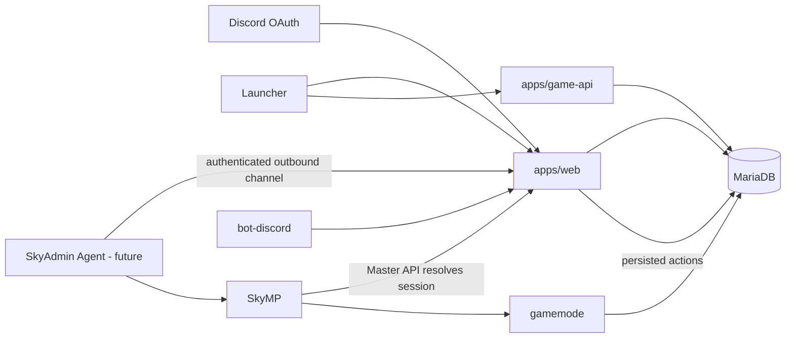

# Target architecture



## Canonical identity

| Identifier | Owner | Use |
|---|---|---|
| `discord_id` | Discord | external login and bot identity |
| `account_id` | MariaDB `accounts.id` | permanent internal identity |
| online `profileId` | Master API/SkyMP | the `account_id` resolved from the session |
| `character_id` | MariaDB `characters.id` | approved character |
| `actorId` | SkyMP runtime | connected, temporary entity |

Mandatory flow: Discord authenticates the account; the launcher receives an opaque ticket; `game-api` creates `game_sessions`; the Master API returns `game_sessions.account_id`; SkyMP uses that value as `profileId`; the gamemode loads that account's character.

## Administrative components

### Web panel

Responsible for authentication, reading, authorization, payload validation, action creation, auditing and UI. It does not talk directly to `mp`, a shell or arbitrary files.

### MariaDB

Stores the entities and the queue. Domain state changes and event/outbox creation happen in the same transaction.

### Future Agent

A local process on the SkyMP host, connected outbound to the panel. It receives only allowed catalog commands, confirms execution and reports heartbeat, logs and metrics. It must not accept free-form commands.

## Administrative action contract

```json
{
  "actionId": "uuid",
  "requestId": "uuid",
  "idempotencyKey": "stable string per user attempt",
  "type": "moderation.kick",
  "actorAccountId": 12,
  "targetAccountId": 42,
  "reason": "required text",
  "payload": {},
  "status": "pending"
}
```

States: `pending`, `dispatched`, `acknowledged`, `succeeded`, `failed`, `cancelled`, `expired`. Every transition is recorded; `succeeded` cannot go back to `pending`.
