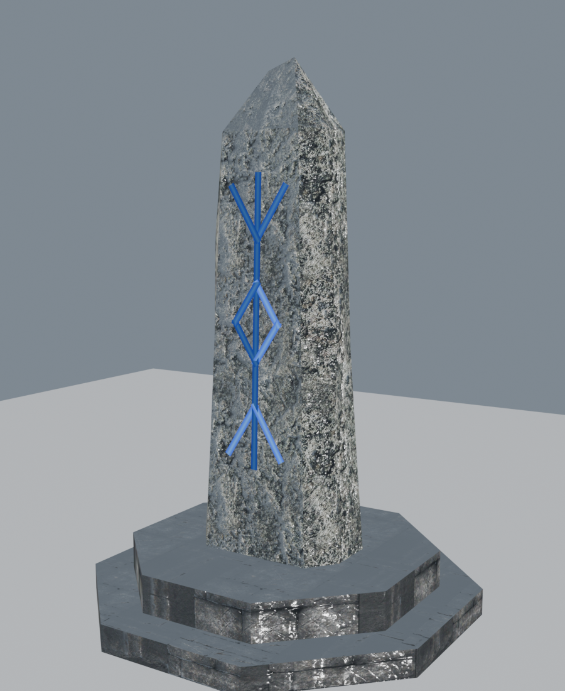

# Holdstone model



The in-game holdstone: a hewn monolith on a two-step Nordic plinth, with
glowing icy-blue runes on its front and back. About 2.9 m tall, 2.1 m across
the plinth, with collision.

`dist/` holds the finished files, laid out the way they go into Skyrim's
`Data/` folder:

| File | What it is |
|------|------------|
| `Oathbound_Holdstone.esp` | ESL-flagged plugin: one activator per stone listed in `skymp/gamemode/data/holdstones.json` ("Whiterun Holdstone" `801`, "High Hrothgar Holdstone" `80B`…), plus the old generic "Holdstone" (`800`), which belongs to no one |
| `meshes/oathbound/holdstone.nif` | the model (shared by every stone) |
| `textures/oathbound/holdstone/*.dds` | rune colour, glow and normal maps |

The stone and plinth use vanilla Windhelm stone textures, so players need
nothing extra for those.

## Placing stones (Creation Kit only)

Load `Oathbound_Holdstone.esp` (and your placement plugin, e.g.
`Oathbound_Core.esp`), find the stone under **Activators** (filter `OBHoldstone`),
drag it into the cell and save. That is all: the server knows a "Whiterun
Holdstone" belongs to Whiterun from its activator. Pressing **E** on it opens
that organization's menu. Several references of one activator are all that
organization's stone.

**Adding a stone** (a thanedom, a faction): append an entry to
`holdstones.json` with a new, never-used `formId`, rebuild the plugin
(`node tools/holdstone/build-plugin.js`), place it in the Creation Kit, and
restart the server (it creates the organization with the default ladder of its
kind). Never change or reuse a `formId`: placed stones point at it.

## Rebuilding

```
node tools/holdstone/build.js             # build into dist/
node tools/holdstone/build.js --install   # build, then copy into skymp/client-mods/
```

Needs Blender 5.x with the PyNifly add-on, and the Skyrim SE `Data/` folder
(read only: two vanilla NIFs and the stone textures are read from its BSAs).
Override paths with `BLENDER` and `SKYRIM_DATA`. After `--install`, restart
the server so the launcher publishes it.

| Script | Step |
|--------|------|
| `bsa.js` | lists and extracts files from SSE BSAs |
| `make_dds.js` | writes the rune textures |
| `build_holdstone.py` | Blender: builds the geometry, collision and materials, exports the NIF, renders `preview.png` |
| `set_glow.js` | sets the rune's glow colour (PyNifly exports it black) |
| `build-plugin.js` | writes the plugin |
| `check_nif.py` | prints shaders, textures and collision of a NIF, to check the result |

The shape is in `build_holdstone.py`: plinth sizes, the monolith's taper
(`Z0`, `Z1`, `HX0`…), and the rune strokes (`STROKES`, as x/z pairs on the
front face).
